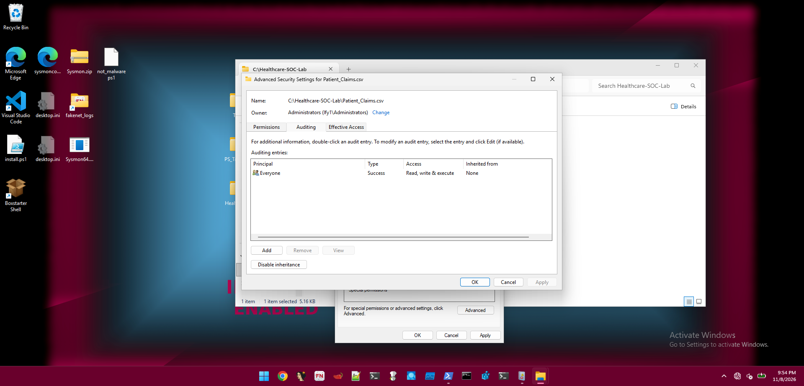
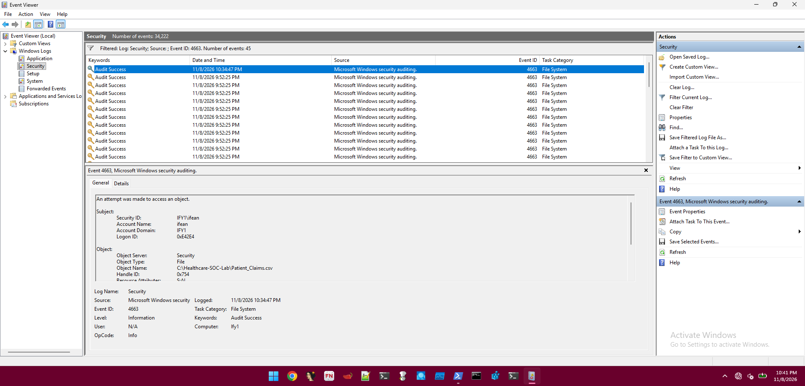
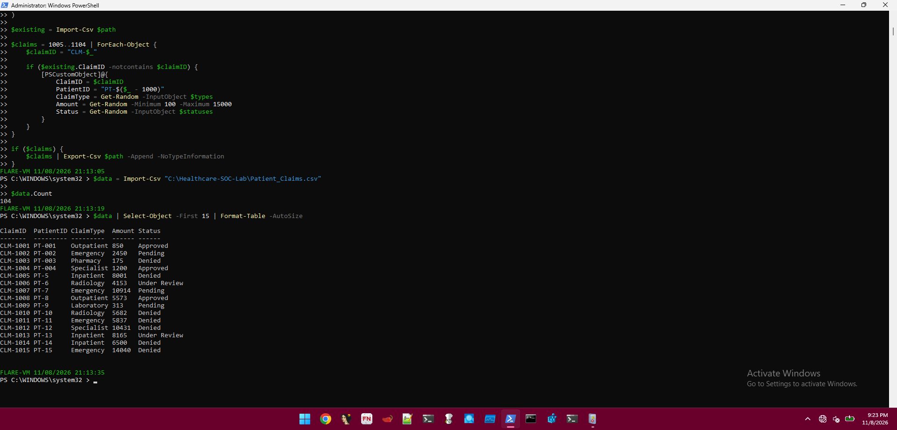

# Healthcare SOC — Claims File-Access Monitoring Investigation

**Project type:** Windows endpoint security monitoring and SOC triage lab  
**Environment:** Windows 11 FLARE-VM on Oracle VirtualBox  
**Data:** 104 fully synthetic healthcare claims (no real patient data)  
**Disposition:** Authorized test activity; **no confirmed security incident**

## Overview

This project demonstrates how a SOC analyst can investigate access to a fictional healthcare claims dataset by combining **Windows Security Event ID 4663** (file-object access) with **Sysmon Event ID 1** (process creation). The investigation focuses on answering *who accessed the file, which process was involved, what operation occurred, and what the evidence does—and does not—establish*.

The lab represents a healthcare claims-processing context, but is **not** an EHR system, a real breach, or proof of HIPAA compliance.

## Investigation question

> Was access to a monitored synthetic patient-claims file associated with suspicious or unauthorized activity?

## Lab setup and methodology

1. Validated Windows security logging and Sysmon process telemetry.
2. Created `C:\Healthcare-SOC-Lab\Patient_Claims.csv` with 104 synthetic claims.
3. Enabled the Windows **File System** audit subcategory for success and failure.
4. Configured a file-specific **success** audit entry for read/write/execute access.
5. Created a local test account (`claims.employee`), but attempts to launch a session using `runas` did **not** succeed.
6. Performed an authorized file read from the existing account using PowerShell:

   ```powershell
   Get-Content "C:\Healthcare-SOC-Lab\Patient_Claims.csv" | Out-Null
   ```

7. Examined Windows Security Event 4663 and correlated the process and logon identifiers with Sysmon process-creation events.

## Findings at a glance

| Source | Observed evidence | Interpretation |
|---|---|---|
| Windows Security, ID **4663** | Nov 8, 2026, 10:34:47 PM (VM local); account `IFY1\ifean`; object `C:\Healthcare-SOC-Lab\Patient_Claims.csv` | Audited access to the claims file |
| Event 4663 access details | `ReadData`, access mask `0x1`, process `powershell.exe`, PID `0x198c` | File data was read by PowerShell; `0x198c` = **6540** decimal |
| Sysmon, ID **1** | `runas.exe` at 10:32:46 PM and `whoami.exe` at 10:33:11 PM, both with parent PowerShell PID **6540** | Supports same-session/process-context correlation; **not** direct proof of the PowerShell creation event |
| Windows + Sysmon | Logon ID `0xE42E4` in the 4663 record and corresponding Sysmon child-process records | Strengthens cross-log correlation |
| `runas` test | `RUNAS ERROR: Unable to acquire user password` | No successful `claims.employee` session established |

**Conclusion:** The reviewed file read is consistent with the analyst's authorized test. **No evidence reviewed establishes unauthorized access, exfiltration, or compromise.**

## Evidence highlights

**File-specific audit policy:**  


**Security Event 4663:**  


**Claims dataset validation:**  


See [Evidence index](Evidence/Evidence-Index.md) for the full screenshot inventory and caveats.

## SOC triage and recommended controls

- Maintain least-privilege access to sensitive claims repositories.
- Enable targeted object-access auditing with appropriate retention and review.
- Forward Windows Security and Sysmon events to a SIEM for cross-host correlation.
- Alert on anomalous volume, time-of-day, and process patterns when reliable baselines are available.
- Protect production healthcare data through applicable security and privacy controls; this lab does not assess compliance.

## Limitations

- Data is fictional; this was a controlled single-VM exercise, not a production healthcare environment.
- The screenshots do not themselves show the full 4663 process/access fields; those fields were separately transcribed from the event during investigation and are recorded in [Investigation Notes](Evidence/Investigation-Notes.md).
- A saved 4624 screenshot exists, but its event was not tied conclusively to the 4663 session; it is not used as proof of a specific login.
- The original 104-row CSV **was not included** in the supplied evidence archive. Add it to `Dataset/Patient_Claims.csv` before publishing if you want the dataset included.
- No MITRE ATT&CK technique is assigned: there is insufficient evidence of adversarial behavior.

## Repository layout

```text
Healthcare-SOC-Project/
├── README.md
├── Dataset/
│   ├── README.md
│   └── Patient_Claims.csv       # add original synthetic CSV before publishing
├── Evidence/
│   ├── Evidence-Index.md
│   └── Investigation-Notes.md
├── Reports/
│   └── SOC-Investigation-Report.md
└── Screenshots/
    └── *.png
```

## Skills demonstrated

Windows Event Viewer · Windows object-access auditing · Sysmon · PowerShell · Event ID 4663 · Event ID 1 · Process-ID and logon-ID correlation · Evidence handling · SOC incident triage · Technical reporting

> **Privacy check before publishing:** Screenshots include a Windows account name, device name, and local paths. Review and redact identifiers you do not want public. Do not upload passwords, credentials, real patient data, or internal corporate information.
